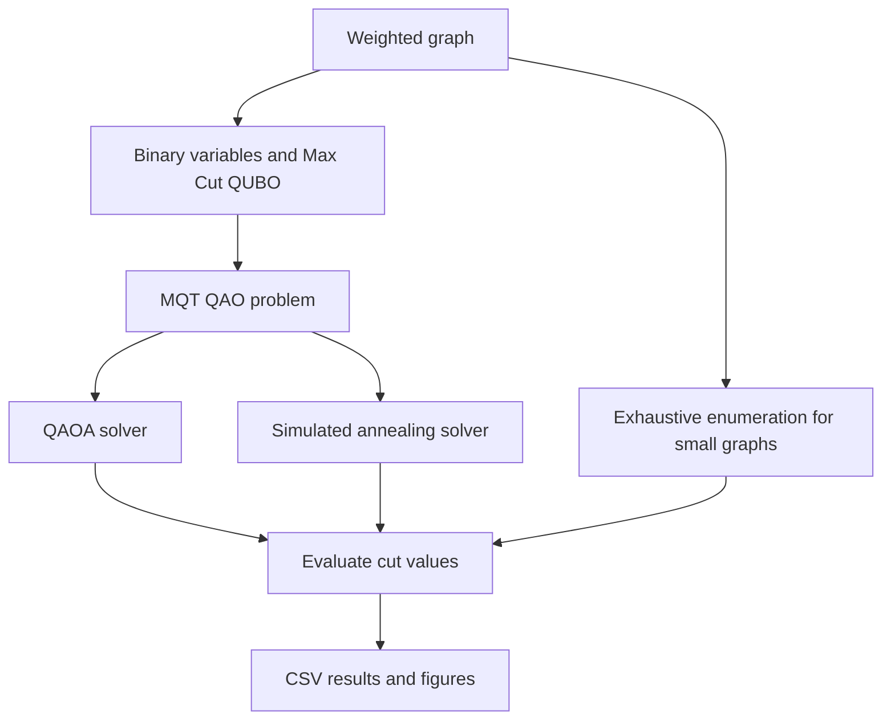

<div align="center">

# Max Cut Optimization with MQT QAO

**Comparing the Quantum Approximate Optimization Algorithm with simulated annealing on weighted graphs**

Python · MQT QAO · QAOA · Simulated Annealing · NetworkX

[Overview](#overview) · [Results](#results) · [Run the experiments](#run-the-experiments) · [Method](#method) · [Limitations](#limitations)

</div>

---

## Overview

**Can a quantum optimization approach recover the optimal Max Cut partition, and how does its runtime change as circuit depth increases?**

This experimental project formulates **weighted Max Cut** as a quadratic unconstrained binary optimization (QUBO) problem using the [Munich Quantum Toolkit's MQT QAO](https://github.com/cda-tum/mqt-qao) framework. It compares:

| Approach | Role |
| --- | --- |
| **QAOA** | Quantum approximate optimization approach, run through MQT QAO |
| **Simulated annealing (SA)** | Classical optimization baseline |
| **Exhaustive search** | Exact reference for graphs with at most 10 vertices in the provided experiments |

The repository contains the experiment scripts, recorded CSV results and plots. It is a **small instance demonstration**, not evidence of quantum advantage.

## At a glance

| | Recorded observation |
| --- | --- |
| **3 graph instances** | One weighted four vertex graph and two seeded random weighted graphs with 8 and 10 vertices |
| **3 QAOA depths** | 1, 2 and 3 repetitions per graph |
| **9 configurations** | One recorded result per graph and depth |
| **9 / 9 matched the exact optimum** | Both the recorded QAOA and SA solutions matched exhaustive search |
| **Runtime increased with depth** | QAOA solve times grew in every graph instance |

> **Key finding:** On these small instances, increasing QAOA depth did not improve the **best cut value reported**, although the recorded solve time increased substantially. This observation does not establish how QAOA scales or how reliably it succeeds across independent trials.

## Results

### The optimization target

Max Cut partitions graph vertices into two groups to maximize the total weight of edges crossing between groups.


### Recorded experiment summary

Cut values are graph specific. The values across different graphs should **not** be treated as directly comparable performance scores.

| Graph | QAOA depth | QAOA cut | SA cut | Exact optimum | QAOA time |
| :--- | ---: | ---: | ---: | ---: | ---: |
| Weighted 4 vertex example | 1 | 4.100 | 4.100 | 4.100 | 2.93 s |
| Weighted 4 vertex example | 2 | 4.100 | 4.100 | 4.100 | 8.00 s |
| Weighted 4 vertex example | 3 | 4.100 | 4.100 | 4.100 | 31.58 s |
| Random 8 vertex graph, seed 42 | 1 | 13.514 | 13.514 | 13.514 | 9.65 s |
| Random 8 vertex graph, seed 42 | 2 | 13.514 | 13.514 | 13.514 | 24.32 s |
| Random 8 vertex graph, seed 42 | 3 | 13.514 | 13.514 | 13.514 | 71.22 s |
| Random 10 vertex graph, seed 7 | 1 | 20.626 | 20.626 | 20.626 | 19.55 s |
| Random 10 vertex graph, seed 7 | 2 | 20.626 | 20.626 | 20.626 | 54.97 s |
| Random 10 vertex graph, seed 7 | 3 | 20.626 | 20.626 | 20.626 | 238.45 s |

These are **previously recorded runs**, not fresh measurements. Timing depends on the machine and software environment. See the [source CSV files](results/) and [full generated table](results/summary.md).

<table>
<tr>
<td width="50%"></td>
<td width="50%"></td>
</tr>
<tr>
<td align="center">8 vertices, edge probability 0.6, seed 42</td>
<td align="center">10 vertices, edge probability 0.6, seed 7</td>
</tr>
</table>

### What the results support

1. **Correctness on the sampled instances:** Reported solutions from both solvers attained the exhaustive search optimum.
2. **Depth versus cost:** For the recorded configurations, deeper QAOA increased solve time without changing the best cut.
3. **Reproducible experiment structure:** Graph settings, solver depth, cut values and QAOA timings are saved in CSV files.

The CSVs contain **best solution values**, not full distributions of measurement outcomes, per restart traces or robust success probabilities.

## Run the experiments

**Requirements:** Python and a working installation of the pinned packages in [requirements.txt](requirements.txt). The code was developed against specific package versions; newer environments may require dependency adjustments.

```bash
git clone https://github.com/ManasviK24/mqt-qao-maxcut.git
cd mqt-qao-maxcut
python -m venv .venv
```

Activate the environment:

```powershell
# Windows PowerShell
.venv\Scripts\Activate.ps1
```

```bash
# Linux or macOS
source .venv/bin/activate
```

Install dependencies:

```bash
python -m pip install -r requirements.txt
```

Run from the **repository root** because the scripts write to relative `results/` and `figures/` paths.

```bash
# Four vertex demonstration and exact verification
python src/maxcut_qao.py

# QAOA depth sweep on the four vertex example
python src/sweep_qaoa.py

# Seeded random weighted graphs
python src/sweep_random_maxcut.py --n 8 --p_edge 0.6 --seed 42 --reps 1 2 3 --num_runs 5
python src/sweep_random_maxcut.py --n 10 --p_edge 0.6 --seed 7 --reps 1 2 3 --num_runs 5

# Regenerate the Markdown summary from the CSV files
python src/summarize_results.py
```

> Reexecuting a script can overwrite a committed CSV or figure. Results may vary because stochastic solvers are involved, even when the graph generation seed is fixed.

## Method

For a weighted undirected graph `G = (V, E)`, assign a binary variable `x_i ∈ {0, 1}` to each vertex. The objective is:

```text
maximize  Σ wᵢⱼ (xᵢ + xⱼ − 2xᵢxⱼ)
          (i,j)∈E
```

Each edge contributes its weight when its endpoints belong to different partitions and zero otherwise. This gives the QUBO representation used by the scripts.



The QAOA runs use `reps = 1, 2, 3` with `num_runs = 5` inside the solver calls. **Five internal runs are not the same thing as five separately reported experimental trials.** The random graph generator uses edge probability `0.6` and assigns weights from `[0.5, 1.5]` by default.

For implementation details and interpretation, see [Experiment notes](docs/EXPERIMENTS.md).

## Project structure

```text
.
├── src/
│   ├── maxcut_qao.py           # Four vertex example, SA, QAOA, exact check
│   ├── maxcut_utils.py         # Cut scoring, exhaustive search, graph plotting
│   ├── sweep_qaoa.py           # Depth sweep on the example graph
│   ├── sweep_random_maxcut.py  # Configurable seeded random graph experiments
│   └── summarize_results.py    # Rebuild a Markdown result table
├── results/                    # Recorded CSV datasets and generated summary
├── figures/                    # Recorded output visualizations
├── docs/
│   └── EXPERIMENTS.md          # Experimental design and caveats
├── requirements.txt
└── LICENSE
```

## Limitations

* **Small sample:** Only three graph instances are represented in the committed results.
* **No hardware demonstration:** The repository does not document execution on a quantum processing unit.
* **No statistical uncertainty:** The saved tables do not establish success rates across independent solver trials.
* **Incomplete runtime comparison:** QAOA time is recorded per depth, but the CSVs do not preserve simulated annealing runtime, so they do not support a rigorous QAOA versus SA timing comparison.
* **No quantum advantage claim:** These experiments cannot establish a performance or scaling advantage over classical methods.
* **Environment sensitivity:** Runtime measurements and repeatability can differ across package versions, platforms and optimizer settings.

## Credits and references

The optimization framework is **MQT QAO**, from the [Munich Quantum Toolkit](https://github.com/cda-tum/mqt-qao). This project uses that framework to implement and evaluate a Max Cut case study; it is not an implementation of the MQT QAO library.

* Volpe et al., *Towards an Automatic Framework for Solving Optimization Problems with Quantum Computers*, IEEE QSW (2024), [arXiv:2406.12840](https://arxiv.org/abs/2406.12840).
* Volpe et al., *A Predictive Approach for Selecting the Best Quantum Solver for an Optimization Problem*, IEEE QCE (2024), [arXiv:2408.03613](https://arxiv.org/abs/2408.03613).

See [LICENSE](LICENSE) for the repository license.
